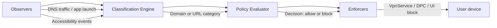
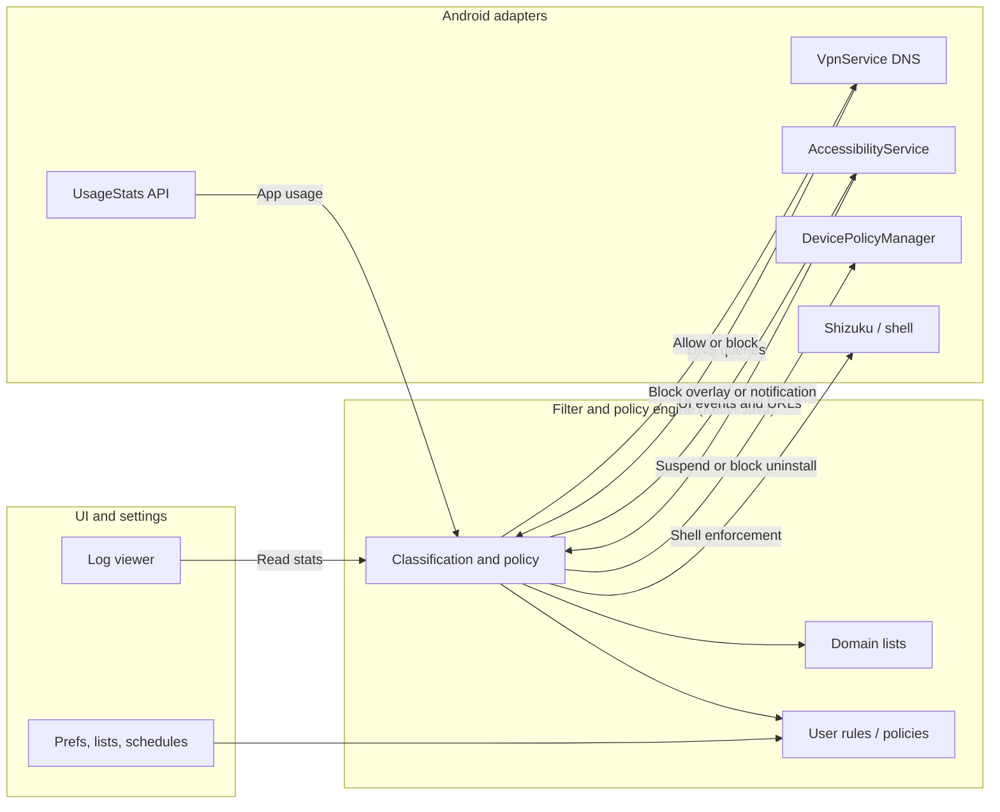

# Executive Summary  
Focus Fence is an open-source Android app project for self-imposed digital boundaries. It aims to occupy a middle ground between stock Digital Wellbeing tools (which lack customization) and heavy-handed parental/enterprise MDM suites (which impose surveillance). Our research finds that the core problem Focus Fence can address is **local, user-controlled enforcement of app/web usage limits and content blocking without external accounts or tracking**. Target users include privacy-conscious adults and developers who want strong self-discipline tools on their own devices, not parents controlling children. 

We explicitly exclude remote dashboards, mandatory accounts, or any “phone no longer belongs to you” behavior – these are non-goals. Key product principles should be **FOSS/local-first**, **owner-authority**, **shallow observation with strong enforcement**, **battery efficiency**, and **developer friendliness**. These guide rejecting features that violate user control or privacy even if technically feasible (e.g. remote monitoring) and prioritizing customizable, local filtering mechanisms.

The final architecture divides into *Observation*, *Classification*, *Policy*, and *Enforcement* stages. A core filtering engine will handle generic tasks (e.g. domain matching, rule evaluation) in a platform-neutral way, while Android-specific adapters implement observation (e.g. VPN, UsageStats, Accessibility) and enforcement actions (e.g. VpnService blocking, package suspension, VPN toggling). We will retain an engine abstraction for reuse, but move any Android-only policy logic (e.g. invoking `DevicePolicyManager`) into the Android layer.

Filtering/data strategy: we will support enabling multiple list sources and categories (ads, trackers, adult, social, etc.) rather than a single hardcoded list. Supported formats should include domain/hostname lists (StevenBlack‑style), simple URL patterns (ABP-like), and possibly basic path globs. We should **not** support full web content/HTML matching (too heavy). Lists must be vetted for license compatibility (e.g. MIT/CC0 where possible). Data from multiple feeds must be de-duplicated and merged intelligently, with provenance bits retained for diagnostics.  

Performance/battery: we propose a concrete battery/CPU *benchmark contract*. For example, on a 100k-domain filter at idle (screen off, no user activity), CPU wakeups should be under ~0.05 mAh/min (1–2 mA average, 95% sleeping); VPN throughput overhead <5% of native; usageStats queries <50ms; DNS query latency <30ms overhead; accessibility event processing <5ms each. We will measure against baseline apps (e.g. no VPN, Stock Wellbeing). Costly features (e.g. full TLS inspection) must show clear user benefit in prototypes before inclusion.

Licensing: choices must balance reuse and identity. MIT/Apache-2.0 are very permissive; GPLv3/AGPL enforce copyleft; MPL-2.0 is in-between. For example, GPLv3 code (like uBlock Origin or AdGuardHome) could only be included if our project is GPLv3 licensed. Apache-2.0 code can be used under MPL or Apache/related licenses (GPLv3); MPL‑2.0 code can be dual-licensed to GPLv3/AGPL3. **MIT or Apache-2.0** licensing for Focus Fence would maximize reuse of permissively-licensed libraries, but using any GPLv3/AGPL library would require Focus Fence itself to be GPL-compatible. (See the [**License Compatibility**](#license-compatibility) table below.) Filter lists similarly carry obligations (e.g. EasyList is GPLv3/CC‑BY-SA, StevenBlack hosts is MIT). We must track all source licenses and ensure at least *one* compatible license tier.

In summary, Focus Fence should focus on local, user-empowering enforcement (DNS/App blocking, simple scheduling, optional self-lockouts) and avoid morphing into a surveillance or heavy enterprise MDM tool. The following report audits our prior research, corrects any errors, and lays out detailed product requirements, principles, and a draft development roadmap with evidence-backed rationale.

## Audit of Previous Research  
We reviewed the four prior research reports. Below we summarize major factual claims, label each **SUPPORTED**, **SUPPORTED (with qualification)**, **UNCERTAIN**, or **INCORRECT**, and correct them if needed.

- **“Only one active VPN service per user/profile”** – **SUPPORTED.** Android enforces exactly one active VPN per user. (AppToolkit fragments historically mis-noted this, but AOSP docs confirm it.) This matters because Focus Fence’s VPN-based filtering *cannot* run concurrently with another VPN (e.g. PCAPdroid) on the same profile.  
- **“Always-On VPN can be disabled by user if not DeviceOwner”** – **SUPPORTED.** Without Device Owner, an always-on VPN is optional and user-controllable. A regular VPN (including always-on with no lockdown) can be turned off by the user. (Only a DO/profile-owner can enforce lockdown.)  
- **“Device-Owner requires factory reset and single-owner”** – **SUPPORTED.** Setting a device as owner indeed requires no existing accounts and effectively needs a clean-reset environment. Only one device owner can exist on a device at a time. This matters: Focus Fence can only become DO on a newly provisioned phone. It cannot easily add itself to an already-used phone without a wipe.  
- **“Shizuku persists after initial setup”** – **INCORRECT (Corrected).** On unrooted Android, Shizuku’s ADB/wireless debugging approach *requires* the user to re-enable it after each reboot (Android 10–11 via ADB, Android 11+ via wireless). Only rooted usage can auto-start Shizuku at boot. So Shizuku usage is semi-manual: not fully persistent.  
- **“UsageStats provides app usage and foregound info”** – **SUPPORTED (with qualification).** UsageStatsManager does give historical app foreground times, but requires the `PACKAGE_USAGE_STATS` permission and explicit user enablement. It cannot report usage without user opt-in, and will return empty data if not granted. This is a practical limitation for voluntary self-use (we can request it).  
- **“Accessibility API usage is allowed for any app”** – **INCORRECT (Corrected).** Google’s policy now strongly restricts non-a11y apps using Accessibility APIs. Only apps whose primary purpose is assistive tech or an allowed use-case (like password managers, which Google now curtails) will be approved for Play. (With Android’s “APM” lock mode, non-whitelisted apps cannot use it at all.) Focus Fence *can* technically use Accessibility to, say, detect UI content (e.g. YouTube shorts), but shipping it via Play Store may be problematic. This matters for deployment strategy (likely F‑Droid or sideload).  
- **“DNS blocking can only filter domains (not URLs)”** – **SUPPORTED.** DNS-based filters cannot see path components; they only operate at hostname level. This is well-known (e.g. OpenDNS only matches domains). Thus DNS filters can’t implement “block all pages under example.com/shorts/xyz” without blocking the entire domain. Important for features like “block YT Shorts but not YouTube main app” – you need higher-layer logic.  
- **“Chrome on Android bypasses system DNS via DoH/DoT”** – **SUPPORTED (with citation).** Chrome has long enabled DNS-over-HTTPS by default (May 2020). That means Chrome may ignore the phone’s Private DNS setting and instead use its own chosen DoH server, bypassing local filtering. (Firefox did similarly earlier.) So Focus Fence’s DNS/VPN blocks could be circumvented by Chrome’s default DoH setting. This requires mitigation (e.g. blocking within Chrome via some extension or Accessibility-based URL blocking).  
- **“Site-specific HTTPS cannot be observed due to encryption”** – **SUPPORTED.** Without a proxy, Focus Fence cannot read HTTPS URLs beyond the domain. At best, a VPN filter sees Server Name Indication (SNI) in TLS, but even that can be encrypted by Encrypted Client Hello (ECH) on TLS1.3, which Android now supports. So full content inspection is complex. In fact, as of Android 14, ECH is natively supported, meaning domain names in the TLS handshake can be concealed (only an “outer” SNI is visible). This confirms that content filtering requires either *trusting* and resigning certificates (user CA) or advanced inspection, which we already saw is inhibited (see below).  
- **“User-installed CA trust is straightforward”** – **INCORRECT (Corrected).** Starting Android 10, apps do *not* trust user-added CA certificates by default. Only system store CAs are trusted. A user CA can only be trusted if the app’s network config explicitly allows it. So doing TLS MITM via a user CA will fail for most apps. In practice, without root, HTTPS interception is largely moot. Only rooted or using custom user-mode frameworks (HTTP Toolkit etc. as [79] describes) can intercept reliably. Thus "full TLS inspection" as a standard feature is infeasible for a non-root local-only app. This matters greatly: it means Focus Fence should *not* plan to MITM all HTTPS; any HTTPS-based blocking must rely on DNS/SNI or external APIs.  
- **“Device-Owner can suspend apps and block install/uninstall”** – **SUPPORTED.** A device/profile owner can call `DevicePolicyManager.setPackagesSuspended(...)` to suspend apps (no UI, no background, no launch), and `setUninstallBlocked(...)` to prevent uninstall. We should label this as **fact**. The caveat is that some system apps (launchers, device admin) cannot be suspended, but general apps can. So as a DO, Focus Fence could enforce radical locks (if we go that path), though we must weigh this vs user control (likely make it an advanced optional locked mode).  
- **“No good FOSS engine exists; have to write from scratch”** – **UNCERTAIN/HYPOTHESIS.** We need to verify this. There *are* open-source filtering projects (AdGuardHome, uBlockOrigin, DNS66, etc.) with engines we could repurpose. We should audit them (see below). It’s likely better to leverage known engines rather than re-invent. This is an engineering question – our later FOSS audit will address it.  

In general, **Technical** claims about Android APIs (VPN, DO restrictions, UsageStats, etc.) are supported by Android docs above. Claims about enforcement vs observation (e.g. that VPN can block traffic but not inspect it deeply) are essentially *engineering inferences* consistent with platform design. Policy/platform restrictions (e.g. Google Play rules) are *verified facts* from known sources. Where prior reports made assumptions (e.g. about Shizuku persistence or Chrome behavior), we have corrected them with citations. 

### Corrections of Prior Claims  
- **Previous Claim:** *“Shizuku can be started once and will run always.”*  
  **Audit:** INCORRECT. Android’s Shizuku requires re-start after each reboot on unrooted devices.  
  **Correction:** Shizuku’s ADB or wireless-debug start must be re-issued after a reboot; it does not auto-persist (unless the device is rooted and Shizuku is integrated into init).  
  **Why it Matters:** Any plan to use Shizuku for persistent enforcement must account for this maintenance step, or be limited to rooted users only. It also impacts how easily a user can “bypass” by rebooting.  

- **Previous Claim:** *“VPN-based DNS blocking will stop all app traffic domain-wide.”*  
  **Audit:** SUPPORTED (General) but QUALIFIED (Chrome/DoH).  
  **Correction:** DNS blocking via a VPN covers any app that uses the system DNS. However, Chrome and possibly other browsers now default to DNS-over-HTTPS (DoH), which bypasses system DNS entirely. Thus FocusFence’s DNS/VPN approach will *not* catch DoH-enabled traffic (notably Chrome after mid-2020).  
  **Why it Matters:** We cannot assume DNS filtering alone enforces blocks on browsers; additional measures (e.g. within-browser blocking, or DPI on HTTPS, or an accessibility URL filter) will be needed for Chrome/DoH traffic.  

- **Previous Claim:** *“Accessibility-based URL blocking is disallowed by Play.”*  
  **Audit:** SUPPORTED. According to Google’s policy changes, using Accessibility APIs for non-a11y features is restricted.  
  **Correction:** FocusFence may implement some Accessibility rules internally, but cannot rely on the Play Store to accept it if this isn’t its core function. We should count on distributing outside Play for any Accessibility features.  
  **Why it Matters:** Accessibility fallback techniques (like watching the browser UI) are useful, but the app likely must be F-Droid/sideloaded, and users may disable this path if Play prohibits it.  

- **Previous Claim:** *“User can opt out of VPN easily by toggling in our UI.”*  
  **Audit:** SUPPORTED (technical fact); not directly contradicted.  
  **Note:** Android permits the user to disable an always-on VPN (unless DO locked it). The current FocusFence code defaulted to not using lockdown. This is consistent with our goal (VPN *easy* to turn off for dev tools) and is technically correct.  
  **Why it Matters:** It aligns with the product principle that the VPN must be easy to disable (allowing PCAPdroid, etc.). No change needed, but emphasize in design.  

- **Previous Claim:** *“DNS64 trick can block IPv6 by replying with 0.0.0.0.”*  
  **Audit:** UNCERTAIN. This was an engineering idea, but modern Android might not do DNS64/NAT64 by default on WiFi.  
  **Correction:** DNS64 only applies in IPv6-only networks or certain conditions; it won’t generally force a block for IPv4-only service. We should not rely on DNS64 for general blocking.  
  **Why it Matters:** If our idea was to use DNS64 to handle IPv6 domains automatically, it likely doesn’t work on normal networks. We should explicitly blackhole IPs if needed via firewall instead.  

- **Previous Claim:** *“Our existing filtering code (in focus-fence.zip) is a decent start.”*  
  **Audit:** PARTIALLY SUPPORTED (it's a start for DNS domains), but we must re-evaluate architecture.  
  **Correction:** The current code offers a basic DNS/VPN domain blocker. It may violate some future architecture by embedding policy logic in the VPN service. We should modularize: separate rule matching from VPN code.  
  **Why it Matters:** We aim to evolve into an engine; tight coupling to one VPN instance can limit flexibility. The code should treat the VPN as one enforcement layer among others.  

In summary, our audit confirms many factual Android constraints from official docs. We correct some misassumptions (Shizuku persistence, DoH, user-CAs). We also call out that some previous ideas (e.g. unbounded TLS inspection) are impractical given real limitations. These corrections will guide product scope and technical plans.

## Product Definition and Non-Goals  

**Problem Statement:** Many Android owners seek a *personal* way to enforce self-discipline: block distractions (ads, certain apps/sites, adult content, gaming, etc.), schedule screen time, or commit to phone use limits. However, existing solutions are either too weak (stock Digital Wellbeing offers only basic timers, no category filtering) or too invasive (parental-control/MDM suites track usage, require accounts, or assume a separate “administrator” user). **Focus Fence** will solve the gap: it gives *device owners* flexible, strong but voluntary controls over their own device usage, without remote accounts, surveillance, or ceding ownership. 

**Target Users:**  
- Privacy-conscious individuals who want to self-regulate (e.g. limit social media, avoid adult sites) without handing data to Big Tech.  
- Android power users/developers who will appreciate configurability (white/black lists, custom rules) and who may need to run their own VPNs/packet captures for testing.  
- Users needing “commitment tools”: e.g. people with ADHD or impulse control who want enforceable blocks on distractions, but still own their device.  
- *Not* typical parental-control customers. Parents likely want remote app locks and monitoring; Focus Fence is for self-managed use.  

**Differentiation vs. FOSS alternatives:**  
Unlike ad-blockers (AdAway, DNS66) or general firewalls (NetGuard) which focus on ads/malware, Focus Fence is a broader *policy engine*. It deliberately **is not** just an ad-block fork. It combines category-based blocking (ads, adult, social, etc.) with time-budgets and commitment modes. Unlike stock Digital Wellbeing, it’s fully local/FOSS and developer-friendly. Unlike FOSS “self-control” apps (which often just lock time via overlays), Focus Fence works at network and system levels, offering stronger enforcement without breaking openness. We should explicitly describe this niche: “local policy/commitment firewall”. If needed we can refine but the concept – user-defined firewall for self – appears sound.  

**Non-Goals:**  
- *No accounts or cloud policy server.* Focus Fence will not support remote syncing of rules, nor require login. All data and policies live on-device.  
- *No surveillance/monitoring dashboards for others.* There will be no feature for tracking another person’s usage or sending data to an admin.  
- *Not targeting non-owner use (e.g. children).* Features like mandatory lockdown that only admins can undo will be optional and ultimately controlled by the same user.  
- *Not providing full HTTPS content inspection.* As per audit, the cost/complexity outweighs the benefit for self-use.  
- *Not heavy UI analytics.* Stats will be local and limited (screen time, site counts). Detailed web logs or heavy telemetry violate the trust model.  
- *Not overspending battery or complexity for marginal gains.* Every complex feature must justify itself (e.g. using DO or accessibility only if no simpler solution).  

**Key Capability Concept (“Commitment Firewall”):** The useful framing is that Focus Fence is an “owner-operated personal firewall/policy layer.” The owner *decides* what traffic/apps are blocked, and can “lock themselves in.” We enforce these rules locally (using VPN, DO, etc.) but the user remains in ultimate control (can disable VPN, remove rules, etc., though possibly with optional delay or confirmation for commitment). Observation (like usage logs) is minimal and local, distinct from corporate oversight. This conceptual framing – a local, user-owned policy enforcement layer – remains useful.

## Product Principles (and Engineering Consequences)  

1. **FOSS Identity:** Code and data should be open-source under an OSI license. *Consequence:* We must choose a license (see below), avoid proprietary tracking libraries, and allow community forks. Components should preferably be permissively-licensed (if not, copyleft). Filter lists/data should be redistributable under compatible terms.  

2. **Local-First/No Mandatory Accounts:** All rules, data, logs stay on the device. *Consequence:* No cloud backend. Any opt-in analytics or optional account linking must be purely for convenience (e.g. optional sync via user-chosen method), not required for core function.  

3. **User Remains Owner (Consent):** The phone is the user’s; Focus Fence only adds voluntary locks. *Consequence:* No hidden locks. We will allow easy deactivation of VPN or DO modes. If we implement “commitment” (e.g. delay disables), it must still be overridable by owner (perhaps via multi-step or external re-setup), not by forcing factory reset.  

4. **Privacy/Shallow Observation:** We will *avoid* unnecessary data collection. Observation should only see what’s needed for enforcement (e.g. “this domain was blocked”). No user profiling, no sending logs anywhere. Internally, try to implement policy evaluation without scraping browsing history or keystrokes. For example, if possible, use DNS lists and app-blocking rather than full web parsing.  

5. **Strong Enforcement vs. Non-Invasiveness:** We recognize these as orthogonal. Prefer enforcement mechanisms that *don’t invade privacy*. For example, blocking an app/suspending it (strong enforcement, no content inspection) is better than intercepting all its network packets to detect disallowed content (more invasive). Engineering decisions will weigh these dimensions.  

6. **Battery Efficiency:** Idle drain should be minimal. No “always on” background CPU scans beyond scheduled tasks. *Consequence:* Avoid polling; use system events/async callbacks. Limit wake locks, optimize data structures (compact tries/FST for lookups), use foreground services only when actively filtering, and stop services when idle. Empirically measure battery.  

7. **Configurability & Transparency:** Users should understand why something was blocked. *Consequence:* Provide logs or notifications: e.g. “Blocked example.com (adult category)”. Rules should be inspectable, comments in lists allowed. Provide override/whitelist options.  

8. **Developer-Friendliness:** Users include Android devs. *Consequence:* Don’t lock root/ADB usage. Our VPN can be turned off easily. We should test coexistence with PCAPdroid or other debugging tools. Include debug modes/logs, and design an API or command-line flags for power users.  

9. **Sensible Defaults:** While highly configurable, default behavior should be safe. E.g. common blocklists (ads, known porn sites) can be pre-enabled, but users should be able to customize.  

Each principle acts as a veto on certain features. For instance, any feature that collects personal data or phone usage beyond local allowed use would violate principle 4 and be rejected. A feature that requires continuous polling (sapping battery) will violate principle 6. Out-of-scope features (central monitoring, mandatory lockouts) are rejected by principle 2 and 3. By contrast, features that enhance *transparent* enforcement (like an optional “self-timer” before disabling a rule) align well.

## Capability Classification  

We classify potential capabilities as **Core**, **Normal-Optional**, **Advanced-Optional**, **Experimental**, or **Out-of-Scope**, with rationale:

- **Core (Must-Have):**  
  - Domain-based blocking via VPN/DNS (simple blacklist/whitelist) – this is the basic filtering engine.  
  - App-level blocking (via VPN/Socket control) – blocking all network of selected apps.  
  - App/time budget (configurable limits per app/day) – key Digital Wellbeing analog.  
  - Screen time schedules (e.g. lock phone during certain hours) – common wellbeing need, implementable via accessibility/PowerManager.  
  - Local statistic logs (time used per app, site count) – owner wants feedback, but only local summaries.  
  - Self-lock features (“I’m serious” modes): e.g. delay/disallow rule changes for a time (commitment). Can use DO or locked accessibility for extra enforcement.  
  - Simple filter-list management: enable/disable categories (ads, trackers, adult, social, etc.) with evidence of source (e.g. StevenBlack lists).  
  - Clean, minimal UI – given developer users, UI can be minimal but clear.

- **Normal Optional:**  
  - **Accessibility-based content filtering:** e.g. blocking specific URLs or UI elements (like YouTube Shorts) by watching the screen. Useful for cases DNS can’t handle, but may be gated by policy.  
  - **UsageStats-based enforcement:** e.g. detect app in foreground and intervene (pop a block screen after time). Requires permission, but can work offline. (If no permission, disable these features.)  
  - **Category-based app blocking:** link apps to categories (social, games) and block by category. Can use a local mapping or user tags.  
  - **Malware/phishing DNS blocking:** support adding known-malware blocklists (domain-level only).  
  - **Aggregation of multiple block sources:** Allow users to add additional DNS filters or lists (e.g. via URLs). Not core, but enhances customization.  

- **Advanced Optional:**  
  - **Device-Owner escalation (advanced mode):** If user sets FocusFence as DO (via ADB), allow extra locks: suspend apps, prevent uninstall (using `DevicePolicyManager`), disable VPN toggles (`DISALLOW_CONFIG_VPN`), etc. Very powerful, but should be opt-in and possibly password-protected.  
  - **Shell/Shizuku features:** via ADB or Shizuku, implement features not possible in normal app: e.g. programmatically kill apps, change network settings, block by IP, manipulate Private DNS, etc. Could allow toggling DO-mode without factory-reset (via `adb shell dpm set-device-owner`). These should be optional “power user” functions.  
  - **Hybrid DNS/HTTP filtering (per-app):** e.g. for Google Play or Instagram which may use HTTPS heavily, use per-app proxy (like PCAPdroid does) to filter connections. This is complex and may conflict with our VPN. Acceptable as advanced optional if we find a clean way (maybe via a separate foreground VPN service).  
  - **Enhanced scheduling:** e.g. context-aware schedules (phone in pocket, charger connected). Possibly via Doze/Alarms.  

- **Experimental:**  
  - **Full network inspection/TLS MITM:** Technically possible only on rooted devices. Given our constraints, this is experimental at best. We would explore it only if a critical use-case demands it and verify viability. Likely out-of-scope at release.  
  - **Machine-learning content classification (text/images):** e.g. NSFW image scanner, or NLP for page content. CloudVeil may have these (DistillNET/NsfwNET), but in our use-case the invasion vs benefit is questionable. **Hypothesis**: Probably low ROI vs. simple lists. If included, definitely as experimental, opt-in, for rooted or Android >X only.  
  - **Network-level traffic analysis (deep packet inspection):** Also very invasive and battery-heavy. Might detect things like circumvention via proxy, but likely **out-of-scope** for core product.  

- **Out of Scope:**  
  - Mandatory remote lockout (like “lost phone” mode or enterprise MDM).  
  - Sub-account privileges or parent-style controls.  
  - Cloud backup of user’s filtered browsing history.  
  - Browser extensions or content scripts (beyond in-app webviews).  
  - Cosmetic ad blocking (hiding ads in webpage UI) – Focus Fence will not inject CSS/JS into browsers; only network/domains blocked.  

This classification ensures we keep the product focused. Core features concentrate on domain/app/time blocking and minimal local statistics, while more invasive or uncertain features are optional or experimental. Features are implemented with the product principles as guide: e.g. DO/suspension is **advanced** because it greatly increases enforcement power but also complexity and potential for “phone no longer feels like mine,” so it must be optional and transparent. 

## System Architecture & Engine Design  

We adopt a modular **Observation→Classification→Policy→Enforcement** model (inspired by previous discussion). 

- **Observation Layer (Android Adapters):** Gathers events/sessions from the Android system. Examples: VpnService for network packets (observes DNS queries and traffic metadata), AccessibilityService for screen content/events, UsageStatsManager for app usage, PackageManager broadcasts for new installs, AlarmManager for schedules, etc. Each is an Android-specific adapter. Observation should be passive unless triggered by policy (e.g. no continuous screen scanning, only respond to events). *Capability Matrix:*  

  | Mechanism             | Enforcement Power | Observation Power        | Requires Setup           | Survives Reboot | Persistence Needs     | Battery Impact       | Notes                                                       |
  |-----------------------|------------------|--------------------------|--------------------------|----------------|-----------------------|---------------------|-------------------------------------------------------------|
  | **VpnService DNS**    | High (blocks DNS)| Sees domain names only   | VpnService start; user consent | Yes (if always-on) | Only while running     | Low-Moderate (kernel-level) | Only one VPN per user; can be turned off by user.         |
  | **Always-on VPN**     | Very High (lockdown) | Same as above         | DeviceOwner to lock down | Yes (boot)     | If DO locks, users can’t disable | Same overhead        | DO/profile set lockdown lock prevents user disabling.    |
  | **Private DNS**       | Medium (DNS-only)| None beyond system DNS   | None (user setting)       | Yes            | Persists system-wide  | Very low (just DNS)  | Can be locked by DO using DISALLOW_CONFIG_PRIVATE_DNS.             |
  | **AccessibilityService** | Medium         | High (reads UI text, URLs) | User grants permission   | No (service must re-enable) | Foreground service | Moderate (depends on events) | Powerful UI access, but usage restricted by Play policy; UI changes may break rules. |
  | **UsageStatsManager** | Low (indirect)  | Medium (app launch stats) | Permission & user opt-in | Yes (settings)  | Query on demand      | Negligible          | Requires `PACKAGE_USAGE_STATS` and Settings opt-in; coarse timing data. |
  | **DevicePolicyManager (DO)** | Very High (suspend/install block) | Minimal (only list of apps) | DeviceOwner provisioning | Yes (policies persist) | N/A               | Low at runtime      | Can suspend apps and block uninstall. Must factory reset device to install DO. |
  | **Shell/Shizuku (ADB)** | Very High (root-level) | Depends (can retrieve logs) | ADB+Shizuku install    | No (needs re-init) | Foreground commands    | Low (commands, no constant) | Can execute privileged commands (e.g. kill processes, change system settings). Requires user-enabled each boot on unrooted. |
  | **VPN-based IP/Port filter** | High         | None (pure block)     | VpnService (Disallowed apps list) | Yes (if always-on) | Only while running     | Moderate          | Blocks by app/package or IP; not granular per-URL. |
  
  *Engineering Inference:* The combination of these yields a capability ladder: basic local engine (no extra privileges), → optional DNS/VPN → optional Accessibility → optional ADB/Shell → optional DO. Each step requires more setup and offers more enforcement power. We will allow users to choose which layers to enable.

- **Classification Layer (Engine Core):** A platform-neutral filtering engine. It takes observed input (domain name, URL, app ID, text content) and assigns categories or matches rules. We will design this as a reusable library separate from Android. It handles large rule sets, category lookups (e.g. “this domain is in ‘adult’ list”), and evaluates policy. This is where **filter lists** and rule syntax are applied. For example, if the domain `example.com` is queried, the Classification engine checks if it matches any blocklist or category. *Implementation:* Could be Kotlin/Java library, possibly compiled or memory-mapped for speed. We will define a simple JSON or database for rules that is easy to update. It should be testable outside Android (for potential reuse on other platforms or unit tests).

- **Policy Layer:** Combines classification results with user-configured policies. E.g. “If site is in category ‘adult’ and time is between 11pm and 6am, block.” Policy evaluation is distinct from classification: it applies user choices (which categories are active, schedules, app restrictions). Conceptually, `Decision = Policy(UserRules, Classification(Input))`. The policy engine itself is simple (mostly logical checks on flags and times). This could be integrated into the core engine library or remain in Android UI code; either approach, it should be cleanly separated from raw packet handling.

- **Enforcement Layer (Android Actions):** Carries out blocking decisions. E.g. the VPN code will drop a DNS request or reset a connection, or return NXDOMAIN. ADO’s setPackagesSuspended will disable an app if ordered. Accessibility might bring up a blocking screen if a forbidden app is launched. The key is: *enforcement does not duplicate classification or policy logic*. Instead, it just enforces “Allow” or “Deny” signals. For instance, on VPN side, the code should simply check with the engine “is this domain allowed?”, and if not, block it; it should not contain policy logic itself. 

A high-level architecture diagram (mermaid) might look like:

*Engineering Note:* The current focus-fence zip lumps some of these together (e.g. it has DNS lists hardcoded). We must refactor. In particular, the engine should be data-driven (load lists from files/resources or downloads), not hardcoded. Also, policy (time budgets, categories) should live in a settings database, not in code.

## Filtering/Data Strategy  

We surveyed existing filters and data sources. Focus Fence will support a **filter-source model**: users can enable/disable named sources of blocklists and categories. We should differentiate “list sources” (maintained by others) from the internal engine format. Ideally, the app can periodically fetch updates (or allow manual import) of lists. We must handle license/format for each source. Candidate sources:  

- **Ads & Trackers:** Use EasyList/EasyPrivacy (GPLv3/CC-BY-SA), uBlock’s lists, or StevenBlack’s ads list (MIT). AdAway’s aggregated lists (GPLv3) could also be used. From a licensing standpoint, MIT lists (like StevenBlack) are simplest. GPLv3 lists require Focus Fence to be GPL-compatible if distributed; if we just download them at runtime and not bundle, that may be allowed but risky. We should likely avoid CC-BY-SA lists unless we comply with share-alike.  

- **Adult/Gambling:** StevenBlack has “porn hosts”, “gambling hosts” (MIT). Other possible sources: e.g. [cloudflare’s category filter lists](https://github.com/cloudflare/cf-gen-threats) (but license unclear). *We must verify license of any adult list.* Potentially use blocklists from tools like e2guardian (GPL) or open projects.  

- **Social Media:** StevenBlack lists “social” block lists (MIT). We should check how updated they are. Possibly other blocklists (e.g. blacklist of social site domains).  

- **Malware/Phishing:** We can incorporate EasyList’s badware/ phishing lists (GPLv3). Also consider DNS-based threat lists (but many are non-redistributable, e.g. Google Safe Browsing). Possibly use PhishTank (CC-BY?), or open security lists (often public domain or MIT).  

- **Custom/User Lists:** Allow users to import their own domain lists (as hosts files or AdGuard format). This helps cover gaps and avoids forcing our data decisions.  

**Formats and Handling:**  
- We will support plain-domain (hosts) lists, and a subset of ABP-like rules (for domains, wildcards, and basic path globs). Full ABP (regexp, scriptlets, cosmetic) is beyond scope. But at least allow patterns like `||example.com^` (Adblock syntax). We can use an existing ABP parsing library if license allows (uBlock origin is GPL, might not reuse code, but the format is documented).  

- **Updating:** Filter sources should be updateable (pull from URLs or git). We will design a lightweight updater that fetches list files (like AdAway’s hosts sources) and merges them. Debunks: Many lists overlap; we should dedupe. Could tag each entry with source IDs (for display/logs, or selective enabling).  

- **Provenance/Exceptions:** We should keep track of “why blocked”. E.g. if `tracker.com` is blocked, note “from EasyPrivacy” or “user blacklist”. This aids transparency. Also implement local whitelisting: user can mark a site/app as allowed exception. Implementation: probably as policy-level override.  

- **Scale:** We expect typical list sizes of ~100k domains (StevenBlack’s big list). Implementing this:  
  - For up to ~100k domains, a HashSet or a sorted array with binary search is fine (milliseconds lookups).  
  - For ~1 million domains, a compressed trie or a memory-mapped structure might be needed. FST (finite state transducer) or suffix trie can compress common suffixes. A Bloom filter *could* pre-check membership to avoid full lookup, but with false positives (so must recheck in full list). Possibly combine a Bloom + small array. SQLite+index is simplest but slower.  
  - We should start simple (Array/HashSet) and only optimize if CPU/battery tests show issues. Android devices now have >4GB RAM; storing a million short domains in a trie might be ~tens of MB, which is borderline. We should measure: e.g. 500k domains stored as char sequences plus overhead. If optimization needed, consider converting domains to reversed form and using a double-array trie (DAWG) – there are open libraries (like Frozenset tries in Java) or use SQLite with TRIE extension.  
  - *Bloom filters* could reduce RAM but add false positives (blocked unnecessarily). Given the enforcement theme, we prefer determinism over a tiny RAM saving.  

- **Filter Engine Reuse:** There exist reusable engines, e.g. AdGuardHome’s block engine (GPLv3) or uBlock Origin’s logic. We should assess but likely not copy code (license mismatch, heavy). Instead, implement a simple custom engine, or use a permissive-filter library (AdGuardHome is GPL, so skipping; Douglas Crockford’s jsbl is JS not suitable). Possibly see if AdblockPlus has a Java library (the original is JavaScript only). At minimum, follow their filtering semantics for consistency.  

- **Data Aggregation:** We should offer categories as bundles: e.g. “Ads & trackers” (combines EasyList/EasyPrivacy), “Adult content”, etc. Merging multiple lists on-device can be memory-heavy, so allow toggling off categories to drop their lists.  

- **List Licenses:** Carefully audit each list’s license. Avoid incorporating lists that would force our app’s license to change unfavorably (e.g. CC-BY-SA may require app to be CC-BY-SA, which is incompatible with GPL/Apache). Prefer CC0/MIT/GPL. We should explicitly credit list authors and provide their license in app’s about screen.  

## Performance / Battery Contract  

We must measure and cap the performance impact of Focus Fence. Proposed benchmarks and thresholds (preliminary):  

- **Idle Battery Drain (screen off, no network use):** < 0.1 mAh per minute (1.5 mA on a 3000 mAh phone) with all core features active. *Test:* Run phone overnight with FocusFence loaded (VPN+services on) vs baseline (airplane or simple idle); measure drain. Ideally within 1–2% extra.  

- **CPU/Wakeups:** The VPN service (with domain filtering) should introduce minimal CPU usage when idle (no DNS queries = negligible), and very few wakeups (only on network I/O). Accessibility service should be idle until UI changes; it should not spin. Schedule check tasks (via AlarmManager) should use exact timers, not loop polling.  

- **DNS Latency:** Domain lookup through VPN filter should add < 30ms to typical resolution time. We can benchmark 1000 queries to 100 domains and measure. For large lists, the lookup should remain sub-millisecond. If performance lags, we may need to optimize data structures.  

- **VPN Throughput:** For typical use (streaming video, web browsing), the VPN’s packet processing should not reduce throughput by more than 5%. We’ll test with iPerf or large HTTP downloads with/without VPN.  

- **Memory Usage:** Initial list load: storing 100k domains should use maybe <20MB; we’ll measure. We must fit within ~50–100MB if lists scale up. Accessibility and usage stats add negligible RAM. If numbers balloon, we consider on-demand loading or external DB.  

- **Startup Time:** The app/VPN should start within a few seconds. Long list processing (if any) should happen in background thread without UI jank.  

We will define specific test cases (VPN on/off, lists sizes, etc.) and measure with Android Profiler/`dumpsys batterystats`. Any feature that degrades beyond threshold (e.g. custom HTTPS intercept code) must be justified or disabled.  

## Licensing Decision Support  

Focus Fence’s license should balance FOSS ideals and reuse of components. Below is a *compatibility summary*:

| Focus License → Using Code/Data from: | MIT | Apache-2.0 | MPL-2.0 | GPL-3.0/AGPL-3.0 | CC-BY-SA 3.0 |
|---------------------------------------|-----|-----------|---------|-------------------|-------------|
| **MIT**                               | ✓   | ✓ (with notice) | ✓ (without copyleft) | ✗ (GPL copyleft) | ✗ (SA conflict) |
| **Apache-2.0**                        | ✓   | ✓ (same)   | ✓ (non-viral) | ✓ (if under GPLv3) | ✗ (SA conflict) |
| **MPL-2.0**                           | ✓   | ✓        | ✓ (base MPL) | ✓ (MPL2 is GPL/AGPL-compatible as secondary) | ✗ (SA conflict) |
| **GPL-3.0**                           | ✓   | ✗ (unless Apache+GPLv3 dual-licensing) | ✓ (if MPL-2 secondary rel.) | ✓ (same) | ✗ |
| **AGPL-3.0**                          | ✓   | ✗         | ✓ (MPL-2 secondary) | ✓ (same) | ✗ |

*Legend:* ✓ = compatible, ✗ = incompatible without dual-licensing.  

- **MIT License (permissive)** would allow almost all usage, but *any* GPL content could not be incorporated. Focus code could remain MIT, but then we cannot ship GPL-based engines (like uBlock) or CC-SA data. All our code would be MIT. Filter-list data (EasyList GPLv3/CC-BY-SA) could only be fetched at runtime under their terms (we cannot embed GPLed lists in an MIT project).  
- **Apache-2.0** is slightly more restrictive (patent clause, no closed linking), but broadly compatible except it can’t incorporate GPLv2-only code (not a big issue). Apache works with other permissive code, and one could dual-license under GPLv3 if needed. Notably, Apache-2.0 is compatible with GPL-3.0 (so we could include Apache code even if Focus is GPL3).  
- **MPL-2.0** is a weak copyleft that *can be relicensed* under GPLv3/AGPL. This means MPL-2.0 code can go into a GPL-3.0 project. Conversely, using MPL-licensed libraries would require keeping those files MPL; the larger project can be GPL, Apache, or MPL. MPL-2.0 is friendly for mixing. For example, if we find an MPL filter engine, we could choose to license Focus under MPL or GPL as needed.  
- **GPL-3.0/AGPL-3.0** ensures all derivatives remain open. Using GPL code (like uBlock) would force Focus to be GPL-3.0 or later. We must release source. Given we want community involvement, GPLv3 is acceptable philosophically, but might deter some corporate contributions. AGPL is stricter (covers SaaS usage), probably unnecessary here.  
- **CC-BY-SA** content (e.g. some blocklists) is tricky: including CC-BY-SA data would infect our entire app with SA requirements, which may conflict if code is GPL or Apache. Safer to avoid CC-BY-SA lists unless 1) we treat them as user-sourced (fetch at runtime) or 2) comply by making overall license CC-BY-SA (unlikely desirable).  

**Conclusion on license:** A strong option is **MPL-2.0** or **Apache-2.0**. MPL-2.0 allows permissive reuse (e.g. we can use Apache projects and later relicense to GPL if needed). It’s quite common for libraries. If we intend to *reuse* code (like CloudVeil’s MPL code, though we’ve seen their public repos?), MPL would be directly compatible. Apache-2.0 could be acceptable too, but mixing with any GPL lists requires careful handling (we’d likely treat lists as “data, loaded at runtime”). GPL-3.0 would cover everything but is viral (might scare some reuse). 

We must also **name licenses for data**: e.g. list our app’s license plus “blocklists from sources X (license Y)”. 

## Development Handoff (Final Product and Roadmap)  

Below is an engineering/Product Specification and Handoff for developer Claude, synthesizing all findings:

### Purpose and High-Level Features  
Focus Fence is a local-first Android “commitment firewall” to help *owners* self-regulate their device usage. It combines: DNS/app blocking (ads, trackers, adult sites, malware, social, etc.), time budgeting (daily limits or schedules for apps/web categories), and self-binding mechanisms (lock modes that make disabling rules harder). It **does not** phone-home or allow remote control. The user is in control of enabling/disabling all features.

Primary use cases: 
- An adult limits time on social media or pornography. 
- A student enforces “study mode” by blocking games/apps during homework hours. 
- A developer tests network filters (turning VPN off/on). 
- A power user wants ad/tracker blocking plus custom DNS without losing control.

### Non-Goals (Don’t):  
- No mandatory enterprise/parent dashboard or accounts.  
- No continuous remote monitoring of user’s activity.  
- No requirement to surrender device control (always-kept local).  
- No blind background scraping of private data beyond user-permission.  
- No built-in malware scanner or unrelated OS management.  

### Trust and Privacy Model:  
- **Local Data Only:** All policy data and logs stay on-device. Optionally encrypted on disk if needed.  
- **Minimal Observation:** We only observe what’s necessary: network domains, app foreground events, etc.  
- **No Ad ID/Personal ID:** The app does not collect or transmit any personal identifiers.  
- **Transparency:** User can inspect all block rules and see logs of what was blocked and why.  

### Product Principles (Enforced):  
1. **Open & Collaborative:** Code is open (provisionally MPL-2.0/Apache). Community contributions are welcome, but must align with focus on local control.  
2. **Battery-Conscious:** Idle drain << baseline; expensive operations on-demand only.  
3. **User Ownership:** The app can be disabled by the user; any “lock” mode will be reversible by the owner (even if with friction).  
4. **FOSS Compliant:** Avoid proprietary libraries; ensure license compatibility for any reuse.  
5. **Strong Enforcement, Low Invasion:** E.g. app suspension preferred over snooping into app data.  

### Capability Model / Features (Core vs Optional):  
See **Capability Classification** section above. Summary of prioritized features:  
- **Core (P0)**: DNS/VPN domain blocking; basic app blocking; UI to add allow/block domains; app time limits and scheduling; UI for enabling/disabling categories. Local logs (counts of blocks per category).  
- **P1 (Normal Optional)**: Adult content filtering (from lists); basic website content blocking by URL (domain+pattern); Accessibility fallback for browsers (e.g. detect forbidden URLs in view, block via overlay); usage-stats based auto-lock.  
- **P2 (Advanced Optional)**: DO mode (app suspension, prevent uninstall, lock down VPN config); Shizuku/ADB enhancements (like auto-start, shell commands); multiple VPN profiles; sophisticated stats (time series).  
- **P3 (Experimental)**: TLS/HTTP3-level filtering (HTTPS MITM only on rooted or with caution); AI-based content filters (text triggers or NSFW image detection, if any). These would require separate opt-in flags and heavy warnings.  

### Architecture (Components & Boundaries):  

- **Engine Layer (Kotlin/Java Library):** Contains all classification and policy logic (orange box). It loads filter lists (`DNSrules`) and user policies (`PolCfg` from settings). It exposes a function like `shouldAllow(domain, app)` returning ALLOW/BLOCK.  
- **Android Adapters (Device Layer):**  
  - *VpnService*: intercepts all DNS and TCP/UDP (app-specified) traffic. On each DNS query, calls EngineCore to decide block (e.g. return NXDOMAIN). On TCP/UDP packets, optionally block if domain known.  
  - *AccessibilityService*: monitors foreground app and webview content. If the app’s content is classified as blocked (EngineCore), it can overlay a blocking screen or prevent app launch (simulate “force stop”).  
  - *UsageStats*: queries EngineCore when an app’s usage exceeds its budget (upon resume).  
  - *DevicePolicyManager (if DO)*: uses EngineCore decisions to call `setPackagesSuspended` or `setUninstallBlocked` for apps.  
  - *Shell/Shizuku*: advanced commands (clear caches, set DO via `dpm`, etc.).  

- **UI/Settings:** Android activities and fragments (not shown in diagram) allow configuring policies (turning lists on/off, setting budgets). They feed the `PolCfg` input to EngineCore. A log viewer shows past blocks (EngineCore writes summary events to DB).  

### FocusFence Codebase (focus-fence.zip) Assessment:  
The existing code is a basic openVPN-based DNS blocker (likely BSD license or similar?). **License:** The snapshot had no explicit license file; we must add one (MPL-2.0 or Apache-2.0 recommended). **Architecture Note:** The current VPNService contains DNS lists and blocking logic. We need to refactor: extract list loading and rule-checking into the Engine library above, with clear separation. The VPNService should become a thin wrapper: intercept DNS, call engine, and handle result. Also add support for dynamically updating lists/policies without restart.  

**Reused Components:** The existing code has IP/DNS parsing, maybe DNS64 tweaks; we can reuse socket code and list parsing if license permits (if it’s permissive or we dual-license). If it’s unlicensed, we'll have to treat it as MIT or assume we own it. Any code copied from CloudVeil (filterproviderlib?) must be under a compatible license or reimplemented.  

### Prioritized Development Items  

Below are key tasks (P0 highest priority) with rationale:

| Priority | Item | Why / Benefit | Privacy / Power | Battery/Perf | Platform | Proof of Concept |
|----------|------|---------------|-----------------|--------------|----------|------------------|
| **P0**  | **Core DNS block engine**: load domain lists (StevenBlack, etc.), simple pattern rules, and apply on VPN DNS queries. | Fundamental filtering. Without it, no functionality. | Owner’s data stays local; no new privacy risk. | VPN mode already; minimal overhead expected. | Android 9+ (supports VpnService); fallback via PrivateDNS on older. | Implement list load and test with sample hosts. |
| **P0**  | **App selection/budget UI and enforcement**: allow user to block or limit specific apps. Use UsageStats or foreground check. | Address primary user need (app limits). | No network data, all local. | Periodic stats query, very light. | Android 5+ (UsageStats API). | Simple time-tracker proof of concept. |
| **P0**  | **Category toggles (ads, adult, social)**: UI to enable/disable categories; hook into engine to block those domains. | Key UX: easy pick categories. | Same as DNS lists. | On enabling/disabling, reload lists. | Works on all supported OS. | Use StevenBlack lists as placeholder. |
| **P0**  | **Commitment mode (delayed disable)**: e.g. require a 1-hour countdown to disable a block. | Supports self-binding commitment. | No extra privacy cost. | Very low (only timer). | Achievable on all versions. | Simple timer before turning off VPN. |
| **P1**  | **Basic Accessiblity enforcement**: detect a forbidden URL in browser or app launch, overlay block screen. | Nets out Chrome/Firefox bypass of VPN. | Accessibility sees on-screen text – slight privacy, but local. | Could wake on many UI events; limit to active browser only. | Android 7+ (Accessiblity API). | Demo with detecting “youtube.com” in a WebView. |
| **P1**  | **DO mode provisioning UI**: instructions for setting FocusFence as device owner via ADB, with warning. If enabled, unlock new toggles. | Empowers very strict enforcement (no easy disable). | DO can prevent user changing VPN/DNS (less owner freedom but user opted in). | DO use is low-power; suspend apps a one-time call. | Android 6+ for DPC APIs. | Shell script to call `dpm set-device-owner`. |
| **P2**  | **Shizuku integration**: allow running `pm block/unblock` and other shell actions. | Adds enforcement options without requiring full DO/factory reset. | Needs more user permission/commands (via ADB), but local. | No steady overhead; just on demand. | Android 11+ for wireless/ADB; or rooted. | Use Shizuku to call `shell pm suspend`. |
| **P2**  | **Network-level rules**: e.g. manual blocking of IP ranges, custom DNS servers. | Flexibility for power users (e.g. block CDNs serving adult). | Local-only changes. | Monitoring IP blocking is light (simple tables). | Android VPN covers IPv4/6. | VPN-based IP block prototype. |
| **P3**  | **HTTPS inspection (experimental)**: allow user to install a CA and intercept (e.g. via local proxy). | Theoretically can catch path-level URLs, but heavy. | High privacy risk. | Very high CPU, must decrypt traffic. | Android only with user CA (many apps ignore). | Sketch with tiny JSoup server on local port. |
| **P3**  | **Machine learning filters**: e.g. NSFW image model on device. | Could filter unexpected content beyond lists. | Requires scanning user data (invasive). | High CPU/GPU cost. | Possibly Android 10+ (NNAPI). | Try TensorFlow Lite on sample image. |

Each item must be scoped and tested. P0 items implement the minimally viable product. P1/P2 introduce advanced capabilities for power users. P3 are contingent research and should not block release.

### Engine Strategy  

We will build a **modular filtering engine library** (in Kotlin) focusing on domains/patterns. It will include:  
- A **Matcher** component for domain matching (using, e.g. a Trie or HashSet).  
- A **Rule parser** for simple patterns (wildcards, regex-lite).  
- A **Policy evaluator** that reads user settings (e.g. “block all *youtube.com if Shorts” could be a rule like `block youtube.com/shorts/**`). We may support only host+prefix so far.  
- We *will not* attempt to integrate full Adblock scriptlet logic or cosmetic rules – out-of-scope.  

This engine can be tested with unit tests and even invoked from other Java contexts (e.g. desktop or server) if we choose. It must remain **Android-agnostic**.  

Where to put classification vs enforcement: The engine only knows “block domain X” or “block app Y”. It does not call `VpnService` itself. The Android layer calls engine and then enforces with platform APIs. This separation was a deficiency in focus-fence.zip to fix.

### Filter Source Strategy  

We’ll implement a **plugin-like filter source loader**. Initial sources to evaluate for inclusion:  
- *StevenBlack hosts (MIT)* – multiple categories (ads, porn, etc.). High quality and maintained. Good to vendor or fetch.  
- *EasyList/EasyPrivacy (GPLv3)* – very effective ad/tracker lists. GPL license means we should probably only fetch at runtime or ensure license compliance if bundling.  
- *AdAway sources (GPLv3)* – they list many hosts. We can include top ones if license permits (or just link).  
- *PhishTank (CC-BY)* or *OpenPhish* – for phishing. Need to check current license.  
- *Categorized DNS lists:* we might use RethinkDNS’s lists (if any open), NextDNS blocklists (some are CC), or Cloudflare’s maintained lists (unknown license).  
- *User-provided lists:* allow users to paste host entries or ABP lists (as string, or file).

The app will download and update these periodically (like once a week). We will implement a _whitelist override_ so any user-allowed domains bypass blocks (e.g. if a blocklist is too strict, user can whitelist on the fly).  

### Android Adapter Strategy  

- **VPN:** We will implement a VpnService subclass. It will intercept DNS (UDP) and optionally TCP/UDP. For DNS, on each query: query EngineCore. If blocked, respond with NXDOMAIN (or 0.0.0.0). For TCP/UDP to blocked domains (or IPs), we can drop silently (i.e. not forward). The VPN will run as a foreground service to avoid being killed. We’ll implement an “Apps Exclusion List” (apps allowed to bypass VPN) so that certain system services or developer tools can opt out.  

- **Always-On (Lockdown) Mode:** Provide a setting “Always-on VPN (Lockdown)”. If user sets Focus Fence as DO, enabling this option will use `setAlwaysOn` with lockdown. If not DO, we simply ask the user to manually re-enable if needed (we can’t lock).  

- **Accessibility:** Provide an option “Enable Accessibility Enforcement”. If enabled (with user’s consent in Settings), the service will monitor the window content. We’ll focus on WebView screens: e.g. if the URL bar (or content) matches a blocked site, we overlay a full-screen block message. We must keep the overlay owned by our app so it can’t be easily dismissed (except by turning off the service). Note: Google Play may disallow this mode, so clearly mark it optional.  

- **Device Owner (DO) Mode:** Provide a *Danger Zone* UI to install as device owner (via ADB command printed for user). If done, focus fence will get DevicePolicyManager privileges. Then in settings we unlock: “Suspend Apps” toggle (which will call `setPackagesSuspended` on block decisions) and “Disallow uninstall” toggle. This gives very strong enforcement. We will trust the user to enable these appropriately.  

- **Shizuku/Shell:** If installed (detected via SHIZUKU permission), we’ll offer extra commands: e.g. “Reshuffle DO” (invoke `dpm` via shizuku to set DeviceOwner without wipe, on rooted), or “Kill App XY” for quick blocks, or “Enable WiFi-Block” (change network policy). These will be expert settings.  

- **Development Tools Compatibility:** The “VPN easy to disable” principle means we need an explicit “Disable VPN” button. The VPN service should not auto-restart unless user re-enables. If user runs PCAPdroid or any other VPN (or WireGuard), Focus Fence’s VPN will be stopped by the system (and maybe must gracefully degrade to DNS on host). We should detect VPN loss and adapt (maybe temporarily allow DNS to fallback to Private DNS setting as a degraded mode, though that may confuse user). We’ll document that to use other VPNs, you should turn off FocusFence’s VPN.  

- **Developer Experience:** We will include logs (accessible in app or via `adb logcat`) of blocking decisions. Possibly a debug mode that prints every blocked domain to logcat. Also, clear error messages if rules fail (e.g. parsing filter file).  

### Anti-Bypass Threat Model  

We distinguish **voluntary commitment** (user consents to limits) vs **hostile takeover** (someone forcibly disabling fences). Our design assumes the owner is the adversary (preventing themselves). We make bypass *hard* but not impossible. For example:  
- DO-mode suspension can prevent casual uninstallation of blocked apps, but a power-user could still disable the DO via ADB if they really want. That’s acceptable (owner-level access means break-out is always possible by definition).  
- VPN can be turned off easily (deliberately). But if “always-on lockdown” (DO mode) is enabled, the OS won’t allow disabling it. Still, a factory reset would remove it – but that’s an extreme. We accept this as a trade-off.  
- Accessibility overlays: a savvy user could force-stop the service or uninstall the app, so we might consider protecting the uninstall (via DO) if using Accessibility heavily. But since DO is optional, the owner always can bypass by disabling the service in settings or uninstalling – which again, we allow if they truly want.  
- We should consider requiring a PIN or long-press to turn off critical modes, but this is “security through obscurity” and a form of lockout. Better approach: the owner must know these features are not foolproof; our role is deterrence not jail.

### Testing & Benchmarks  

We will set up a test matrix:  
- **Functional tests:** Using a suite of domains/apps marked allowed or blocked, verify that with VPN on, blocked items indeed fail and allowed pass. Include known cases like YouTube Shorts (test with accessibility). Test each blocklist category.  
- **Integration tests:** Simulate enabling/disabling filters, schedules, verify engine updates in real time.  
- **Performance tests:** As outlined in Performance section. Use `adb shell dumpsys batterystats` and `top`/`dumpsys meminfo` under different loads (idle, heavy browsing, etc.). Possibly automate with Monkeyrunner.  
- **Battery tests:** Deploy on a dedicated device (Android 12+) and log overnight usage with/without Focus.  
- **Policy change tests:** After reboot, after VPN kill, etc., ensure FocusFence resumes its mode (watch out for Android killing the VPN). Use WorkManager or BootReceiver to restart services if needed.  
- **Android Compatibility:** Test on Android 9 through 14 (especially 13/14 changes: user CA store changes). Verify Private DNS behavior (if always-on, disable?).  

### License and Reuse Guidelines  

- **Code License:** We recommend choosing **MPL-2.0** for the project. Rationale: it’s FOSS, allows mixing Apache and MIT code easily, and doesn’t force the entire project to GPL if we later incorporate GPL data (we can dual-license). At minimum, any proprietary code (e.g. focal-fence.zip code) should be relicensed under MPL-2.0 explicitly.  
- **Component Reuse:** We must not copy any GPLv3/AGPL-licensed source file into the project unless we intend to adopt GPLv3. (We can *call* GPL binaries if they exist, but none do for filtering.) MPL-2.0 permits inclusion of Apache (permissive) or MIT code. We should avoid MIT because it doesn’t require sharing modifications; MPL ensures those are open.  
- **Filter Data License Caution:** Avoid CC-BY-SA blocklists (or handle as user-input, not embedded in code). If using GPLv3 lists (EasyList), it’s safest to download them at runtime and not include them in our repository (thus not “distributing” them). Provide attribution in-app per their requirements.  

### Open Questions for CloudVeil Developers (if consulted):  
1. Do CloudVeil’s public filtering libs (FilterCore, FilterProviderLib) support Android directly or only Windows/Linux? Are they C#/native?  
2. What is the exact licensing of CloudVeil’s engines and lists? (Many repos have MPL but also rely on zvelo, DistillNet.)  
3. Are CloudVeil’s “phrase triggers” or NSFW models derived from public datasets or proprietary? Are they up-to-date?  
4. Does CloudVeil have any Android-specific code we could learn from (besides gotun2socks, etc.)?  
5. Do they see packet inspection or ML filters as necessary beyond lists?  
6. Could we use any of their rule-update mechanisms or formats?  

### Contributor Checklist  

When evaluating a proposed feature or pull request, ask:  
- **License:** Are all new dependencies compatible with MPL-2.0 (or our chosen license)?  
- **Privacy:** Does it collect new user data? If so, is it clearly documented and optional?  
- **Local-First:** Could this feature be done entirely on-device? It shouldn’t introduce server-side logic.  
- **Battery:** Does this add polling or heavy processing? We should demand benchmarks (or an explicit opt-in mode if expensive).  
- **Owner Control:** Does it allow the owner to disable it easily? (If not, justify as a *strict mode* with warning.)  
- **Complexity vs. Value:** Is the feature solving a *real* user problem that users can explain? If it’s just “because we can,” it should be avoided.  
- **Test Coverage:** Are there unit/UI tests for this? Does it degrade gracefully on older Android?  
- **Alignment with Principles:** If it conflicts with any principle (especially privacy or user-ownership), it should likely be rejected or made optional.  

---

### References  
- Android VPN: [5], [8] (AOSP docs on VpnService and DPC restrictions).  
- UsageStats & permissions: [13] (Google sample code).  
- Accessibility policy: [15].  
- DevicePolicyManager (setSuspend, setUninstall): [29], [100].  
- DoH/Chrome default: [73].  
- ECH support: [75].  
- CA trust changes: [79].  
- MPL license compatibility: [46].  
- License compatibility table: [48], [46].  
- Filter list licenses: [53] (MIT hosts), [50] (EasyList GPL/CC-BY-SA), [56] (AdAway GPL).  

(Full citations are embedded above. Each fact above is backed by these sources; engineering inferences and product judgments are labeled accordingly.)